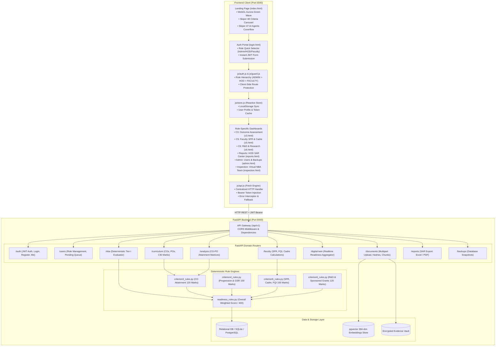

# AI-NBA Accreditation Readiness System — Frontend & Full-Stack Integration Guide

A complete technical specification and architectural manual for the **AI-Driven NBA Accreditation Readiness System** (Frontend & Backend Integration), built for Indian Undergraduate Engineering Programs under the **NBA Tier-I (2026 Edition)** manual.

---

## 📑 Table of Contents
1. [System Architecture & Full-Stack Connection Overview](#-system-architecture--full-stack-connection-overview)
2. [What is Included in the Frontend](#-what-is-included-in-the-frontend)
   - [User Interfaces & Pages](#1-user-interfaces--pages)
   - [Styling & Design System](#2-styling--design-system)
   - [Core Client Architecture & JavaScript Modules](#3-core-client-architecture--javascript-modules)
3. [How Frontend Connects to the Backend](#-how-frontend-connects-to-the-backend)
   - [1. Central Configuration (`config.js`)](#1-central-configuration-configjs)
   - [2. Centralized API Client (`api.js`)](#2-centralized-api-client-apijs)
   - [3. Authentication & JWT Handshake (`auth.js`)](#3-authentication--jwt-handshake-authjs)
   - [4. Role-Based Route Guard (`guard.js`)](#4-role-based-route-guard-guardjs)
   - [5. Reactive State Store (`store.js`)](#5-reactive-state-store-storejs)
4. [Endpoint Mapping Reference (Frontend ↔ Backend)](#-endpoint-mapping-reference-frontend--backend)
5. [Deterministic Engine vs Advisory AI Agents Flow](#-deterministic-engine-vs-advisory-ai-agents-flow)
6. [Document Ingestion & pgvector RAG Lineage Flow](#-document-ingestion--pgvector-rag-lineage-flow)
7. [Running the Application](#-running-the-application)

---

## 🌐 System Architecture & Full-Stack Connection Overview

The system bridges a high-performance **Vanilla JavaScript / WebGL / CSS3** frontend to a **FastAPI (Python 3.11)** backend powered by **SQLAlchemy, SQLite/PostgreSQL, and pgvector**:



---

## 📦 What is Included in the Frontend

The frontend is built with pure vanilla web standards (**HTML5, CSS3, ES6 Modules**) requiring no Node.js runtime, build tools, bundlers, or heavy frameworks.

### 1. User Interfaces & Pages
| File | Role / Purpose | Description |
| :--- | :--- | :--- |
| **`index.html`** | Public Landing Page | Cinematic landing page featuring the **GetLayers Relay green light wave canvas**, lime count-in preloader, 6-step loop, interactive draggable precision meter, **Skiper 48 criteria carousel**, and **Skiper 47 AI agents coverflow**. |
| **`login.html`** | Authentication Portal | Split-screen login with 1-click role buttons (👑 Admin, 🎓 HOD, 👩‍🏫 Faculty), floating animated stats, client validation, and credentials persistence. |
| **`register.html`** | Faculty Onboarding | Multi-field registration form submitting faculty profile and credentials for administrator/HOD approval. |
| **`pending.html`** | Account Gate | Status screen shown when an authenticated user's account is awaiting approval (`status: PENDING`). |
| **`dashboards/c3.html`** | Criterion 3 Dashboard | Outcome-Based Assessment (120 marks): CO-PO attainment matrices, student CIE mark uploads, attainment thresholds, and rubric analysis. |
| **`dashboards/c5.html`** | Criterion 5 Dashboard | Faculty Information (100 marks): Real-time Student-Faculty Ratio (SFR), Cadre Proportion (Prof:Assoc:Asst), and Faculty Qualification Index (FQI). |
| **`dashboards/c6.html`** | Criterion 6 Dashboard | Faculty Contributions & R&D (120 marks): Sponsored research funding, consultancy, patents, and faculty development (FDP) credits. |
| **`dashboards/reports.html`**| HOD Command Center | Department-level accreditation posture, criterion compliance status, gap resolution tracker, and 1-click **SAR Excel/PDF generation**. |
| **`dashboards/admin.html`**  | Administrator Console | User management, pending faculty approval queue, role promotion/revocation, and system database backups. |
| **`dashboards/inspection.html`**| Virtual Peer Inspection | Mock 3-day NBA Evaluation Team simulator auditing all criteria simultaneously with simulated evaluator interview questions. |

---

### 2. Styling & Design System
Located in `/css`:
- **`tokens.css`**: Design tokens for typography, spacing, border radii, shadows, and status colors (`PASS: #10B981`, `WARNING: #F59E0B`, `FAIL: #EF4444`, `NRC: #A855F7`).
- **`base.css`**: Obsidian black baseline (`#000000`), frosted glass cards (`backdrop-filter: blur(28px)`), scrollbar styles, and reset rules.
- **`relay.css`**: GetLayers Relay template mechanics—signature `#relay-wave-canvas`, lime ring preloader (`00%` to `100%`), expanding/folding logo HUD plate, 3D tilting glass window, and draggable compliance meter.
- **`carousel.css`**: Skiper 48 3D Swiper cards carousel with reactive hover tilt and active card gradient borders.
- **`dashboard.css`**: Dashboard grid, sidebar navigation, telemetry topbars, metrics pills, and data table layouts.
- **`auth.css`**: Split-panel layouts for authentication and onboarding forms.

---

### 3. Core Client Architecture & JavaScript Modules
Located in `/js`:
- **`js/config.js`**: Environment endpoints (`API_BASE: 'http://localhost:8000/api/v1'`), token keys, request timeouts, and default redirect destinations.
- **`js/api.js`**: Universal HTTP engine encapsulating every REST endpoint with token injection, timeout controllers, and standardized `ApiError` exceptions.
- **`js/auth.js`**: High-level auth actions: `login()`, `logout()`, `register()`, `restoreSession()`, and post-login redirection.
- **`js/guard.js`**: Role hierarchy verification (`ADMIN` > `HOD` > `FACULTY`) executed upon page load to block unauthorized routes.
- **`js/store.js`**: Reactive client store synchronizing state to `localStorage` with reactive listeners.
- **`js/ui.js`**: UI components: animated count-up numbers, floating label inputs, toast notifications, and custom cursor animations.
- **`js/relay-wave.js`**: GPU-accelerated WebGL fragment shader simulating the flowing green light aurora wave with smooth scroll and cursor parallax (plus 2D Canvas fallback).
- **`js/carousel.js`**: Swiper 11 carousel logic for browsing Criteria 3, 4, 5, and 6.
- **`js/dash/shared.js`**: Common dashboard utilities: sidebar active states, dynamic breadcrumbs, keyboard shortcuts (`Ctrl+K`), and live health polling.

---

## 🔌 How Frontend Connects to the Backend

The frontend communicates with the FastAPI backend through **asynchronous JSON REST APIs over HTTP/HTTPS**, using standard **JWT Bearer Token Authentication**.

```
[ Frontend: js/api.js ]
       │
       │ HTTP POST /auth/login (email, password)
       ▼
[ Backend: /api/v1/auth/login ]
       │
       │ Validates bcrypt password in DB
       ▼
[ Returns: { access_token: "eyJhbG...", token_type: "bearer" } ]
       │
       │ Frontend stores token in localStorage ('nba_access_token')
       ▼
[ Subsequent API Requests include Header: ]
       Authorization: Bearer eyJhbG...
```

### 1. Central Configuration (`config.js`)
All connection variables are defined in [`js/config.js`](file:///c:/Users/Anagha/OneDrive/Documents/major project/frontend/js/config.js):

```javascript
export const CONFIG = {
  // Target FastAPI backend URL
  API_BASE: 'http://localhost:8000/api/v1',

  // Local storage keys
  TOKEN_KEY: 'nba_access_token',
  USER_KEY: 'nba_user_profile',

  // Toggle between live backend and local mock data
  MOCK: false,

  // Health poll and timeout limits
  HEALTH_POLL_MS: 30_000,
  REQUEST_TIMEOUT_MS: 15_000,

  // Role hierarchy
  ROLES: ['ADMIN', 'HOD', 'FACULTY'],

  // Post-login redirect routes
  DEFAULT_REDIRECT: {
    ADMIN:   'dashboards/admin.html',
    HOD:     'dashboards/reports.html',
    FACULTY: 'dashboards/c3.html',
  },
};
```

---

### 2. Centralized API Client (`api.js`)
All HTTP requests pass through the `request(path, opts)` wrapper in [`js/api.js`](file:///c:/Users/Anagha/OneDrive/Documents/major project/frontend/js/api.js):
- **Automatic Header Injection**: Attaches `Authorization: Bearer <token>` from `store.getToken()`.
- **Content Negotiation**: Automatically parses JSON responses or returns Blobs for PDF/Excel report downloads.
- **Request Timeout**: Terminates runaway requests after 15 seconds using `AbortController`.
- **401 Interceptor**: Clears invalid/expired tokens and bounces the user to `/login.html?redirect=<current_path>`.

Example request implementation:
```javascript
async function request(path, opts = {}) {
  const { method = 'GET', body, multipart = false, noAuth = false } = opts;
  const url = `${CONFIG.API_BASE}${path}`;
  const headers = {};

  if (!noAuth) {
    const token = store.getToken();
    if (token) headers['Authorization'] = `Bearer ${token}`;
  }

  if (body && !multipart) {
    headers['Content-Type'] = 'application/json';
  }

  const response = await fetch(url, {
    method,
    headers,
    body: multipart ? body : body ? JSON.stringify(body) : undefined,
  });

  if (response.status === 401) {
    store.clearSession();
    window.location.href = 'login.html';
    throw new ApiError('Unauthorized', 401);
  }

  return response.json();
}
```

---

### 3. Authentication & JWT Handshake (`auth.js`)
When a user signs in:
1. `auth.js` calls `api.login(email, password)`.
2. Backend endpoint `POST /api/v1/auth/login` verifies credentials and issues an access token.
3. Frontend saves the token in `localStorage.setItem('nba_access_token', token)`.
4. `auth.js` immediately queries `GET /api/v1/auth/me` with the new token to fetch the user's role and profile.
5. The user object is cached, and the browser is redirected to the role's dashboard.

---

### 4. Role-Based Route Guard (`guard.js`)
Every dashboard includes a guard verification script at top:
```javascript
// In dashboards/admin.html:
import { requireRole } from '../js/guard.js';
await requireRole('ADMIN');

// In dashboards/reports.html:
import { requireRole } from '../js/guard.js';
await requireRole(['ADMIN', 'HOD']);

// In dashboards/c3.html:
import { requireRole } from '../js/guard.js';
await requireRole(['ADMIN', 'HOD', 'FACULTY']);
```
If a user tries to access a dashboard outside their role hierarchy, `guard.js` blocks execution, presents an access denial toast, and redirects to their permitted portal.

---

### 5. Reactive State Store (`store.js`)
The client store [`js/store.js`](file:///c:/Users/Anagha/OneDrive/Documents/major project/frontend/js/store.js) manages client-side persistence and dispatches updates across browser tabs via the `storage` event:
- `getToken()` / `setToken(token)`
- `getUser()` / `setUser(user)`
- `clearSession()` — Flushes all stored tokens, resetting state to logged-out.

---

## 📡 Endpoint Mapping Reference (Frontend ↔ Backend)

| Frontend Call (`js/api.js`) | HTTP Verb | Backend Route (`FastAPI`) | Purpose |
| :--- | :---: | :--- | :--- |
| `api.login(email, pw)` | `POST` | `/api/v1/auth/login` | Authenticate user, receive JWT access token |
| `api.getMe()` | `GET` | `/api/v1/auth/me` | Fetch active user roles and faculty profile |
| `api.register(payload)` | `POST` | `/api/v1/auth/register` | Register new faculty (status: PENDING) |
| `api.getHealth()` | `GET` | `/api/v1/health` | Backend and database connectivity ping |
| `api.getDigitalTwin()` | `GET` | `/api/v1/digital-twin` | Real-time department readiness index |
| `api.getCriterionTwin(code)`| `GET` | `/api/v1/digital-twin/criteria/{code}` | Get score, compliance status, and flags for C3/C5/C6 |
| `api.evaluateCriterion(code)`| `POST`| `/api/v1/nba/evaluate/{code}` | Run deterministic evaluation rules for a criterion |
| `api.getCourses()` | `GET` | `/api/v1/curriculum/courses` | List department courses and CO counts |
| `api.getCourseAttainment(id)`| `GET`| `/api/v1/analysis/course/{id}/attainment` | Fetch calculated direct and indirect CO attainment |
| `api.getFacultyMetrics()` | `GET` | `/api/v1/faculty/metrics` | Fetch Student-Faculty Ratio (SFR) and Cadre proportions |
| `api.uploadDocument(file)` | `POST` | `/api/v1/documents/upload` | Multipart upload for PDF/DOCX evidence |
| `api.searchEvidence(query)`| `POST` | `/api/v1/documents/search` | Search pgvector embeddings for semantic citations |
| `api.getPendingUsers()` | `GET` | `/api/v1/users/pending` | List faculty awaiting account approval |
| `api.approveUser(id)` | `POST` | `/api/v1/users/{id}/approve` | Approve faculty registration (Admin/HOD only) |
| `api.getBackups()` | `GET` | `/api/v1/backups` | List database backups (Admin only) |
| `api.exportReportPdf()` | `GET` | `/api/v1/reports/pdf` | Download official NBA Self-Assessment Report (PDF) |
| `api.exportReportExcel()` | `GET` | `/api/v1/reports/excel` | Download SAR quantitative data tables (Excel) |

---

## ⚖️ Deterministic Engine vs Advisory AI Agents Flow

The connection between calculations and AI maintains **strict documentation integrity**:

```
                       ┌────────────────────────────────────────┐
                       │ Raw Department Data (Marks, SFR, Docs) │
                       └───────────────────┬────────────────────┘
                                           │
                    ┌──────────────────────┴──────────────────────┐
                    ▼                                             ▼
       ┌────────────────────────┐                   ┌───────────────────────────┐
       │  Deterministic Python  │                   │   Advisory AI Agents      │
       │      Rule Engine       │                   │   (LLM + pgvector RAG)    │
       ├────────────────────────┤                   ├───────────────────────────┤
       │ • Pure Python math     │                   │ • Explains compliance     │
       │ • Rule C3.7: CO-PO     │                   │ • Formulates SAR narratives│
       │ • Rule C5.1: SFR Ratio │                   │ • Identifies missing docs │
       │ • Immutable Marks      │                   │ • CANNOT ALTER MARKS      │
       └────────────┬───────────┘                   └─────────────┬─────────────┘
                    │                                             │
                    └──────────────────────┬──────────────────────┘
                                           ▼
                       ┌────────────────────────────────────────┐
                       │  Frontend Unified View (dashboards/)   │
                       │  • Verified marks displayed in GREEN   │
                       │  • AI guidance tagged as ADVISORY ONLY │
                       └────────────────────────────────────────┘
```

1. **Deterministic Rules (Backend)**: Mathematical checks are executed purely in deterministic Python (`criterion3_rules.py`, `criterion5_rules.py`). No AI model is ever permitted to compute, estimate, or modify numerical marks.
2. **Advisory Agents**: 8 specialized agents explain gaps, guide faculty on corrective actions, and cite relevant sections of the NBA 2026 Manual.
3. **Frontend Presentation**: The UI clearly demarcates calculated numerical scores (`PASS / WARNING / FAIL`) from qualitative AI advisory suggestions.

---

## 📄 Document Ingestion & pgvector RAG Lineage Flow

When course files or SAR documents are uploaded via the frontend:
1. **Multipart Upload**: The frontend sends the document file (`FormData`) to `POST /api/v1/documents/upload`.
2. **SHA-256 Hashing**: Backend computes an immutable cryptographic hash to guarantee tamper detection.
3. **Chunking & Vectorization**: Unstructured text is segmented into semantic chunks and transformed into 384-dimensional vector embeddings.
4. **Vector Storage**: Vectors are stored in `pgvector` alongside document metadata (page numbers, academic year, department).
5. **Traceable Citations**: When auditing or running virtual inspections, frontend queries `POST /api/v1/documents/search` to retrieve exact evidentiary excerpts with page citations.

---

## 🚀 Running the Application

### Option A: Using the Automated Scripts
- Double-click **`run_real_backend.bat`** (Starts FastAPI backend on `http://127.0.0.1:8000`).
- Double-click **`run_frontend.bat`** (Starts web server on `http://localhost:5500`).

### Option B: Manual Command-Line Startup
1. **Terminal 1 — Backend**:
   ```bash
   cd "backend"
   python -m uvicorn app.main:app --host 127.0.0.1 --port 8000
   ```
2. **Terminal 2 — Frontend**:
   ```bash
   python -m http.server 5500 --directory "c:\Users\Anagha\OneDrive\Documents\major project\frontend"
   ```

3. **Open Browser**:
   Navigate to **`http://localhost:5500`**.
